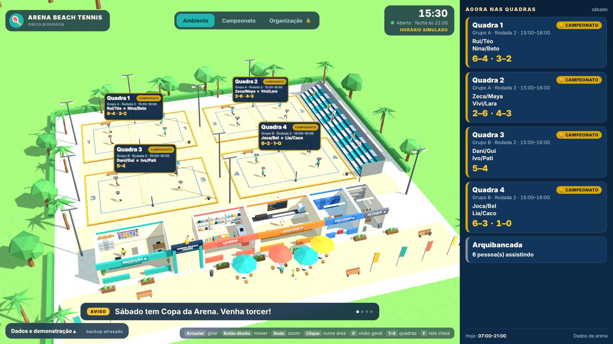
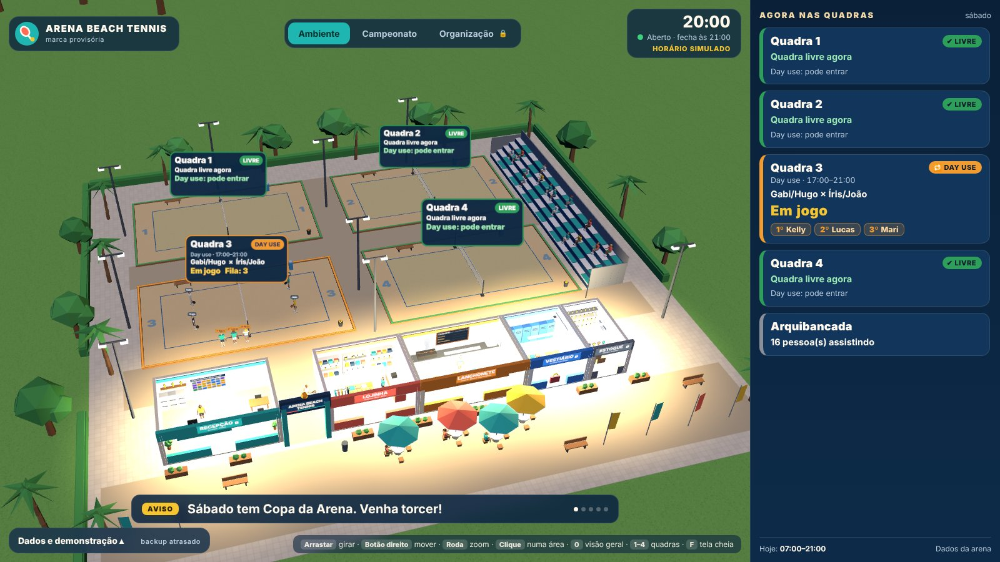
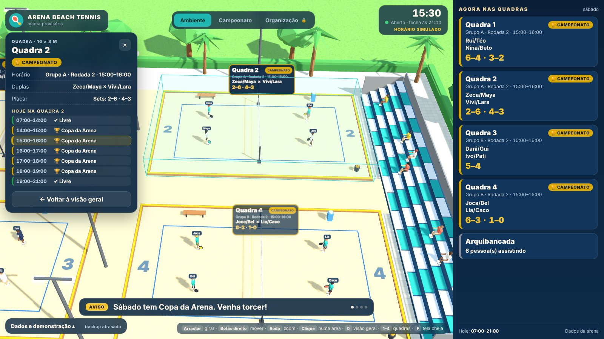
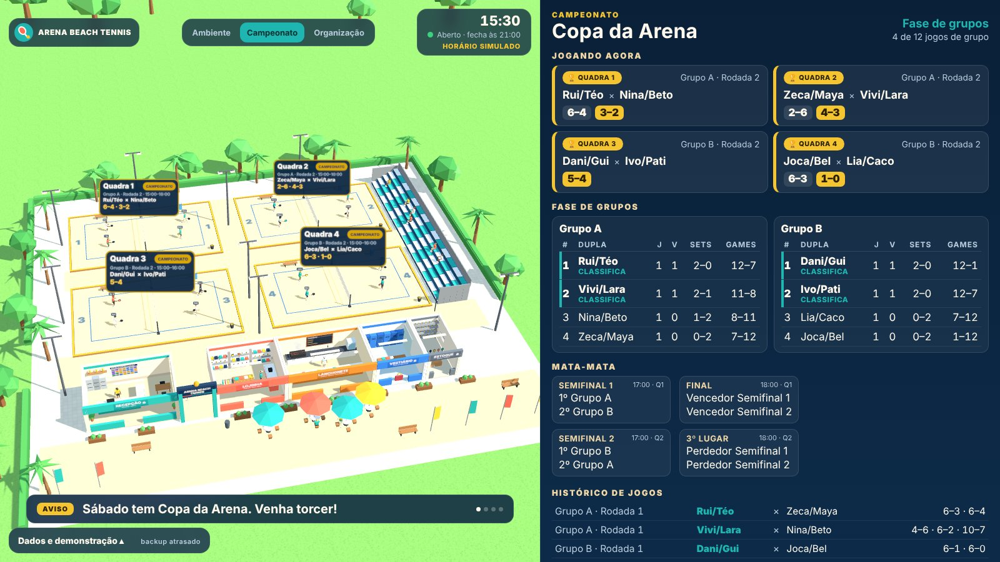
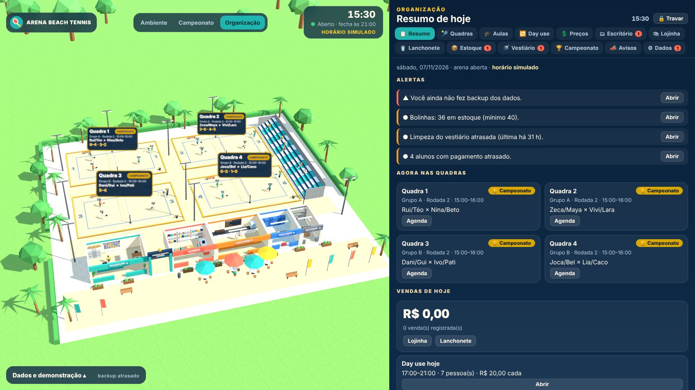
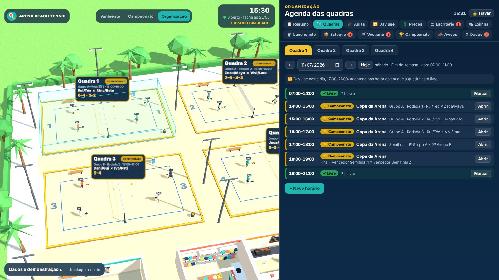
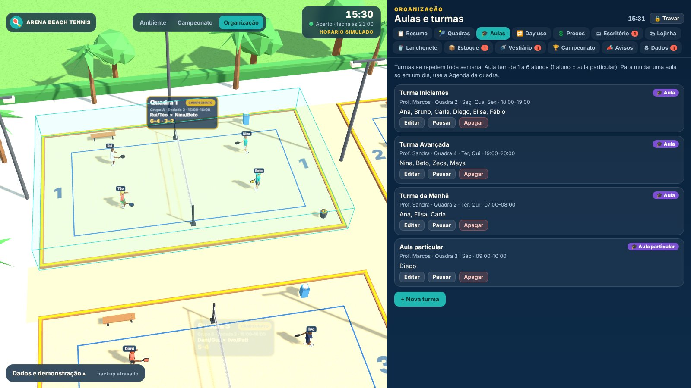
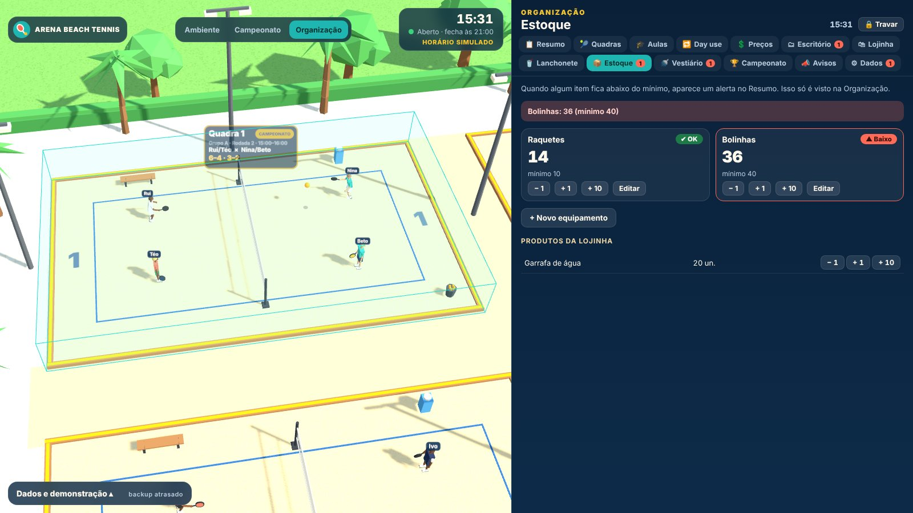

# Gestão Beach Tennis 3D

**A sua arena viva na TV, e a gestão inteira num só lugar.** Uma maquete 3D animada mostra em tempo real quem está jogando em cada quadra, o placar do campeonato e os avisos do dia, enquanto a equipe cuida de agenda, aulas, day use, vendas e estoque numa área protegida por PIN.

Roda **só no navegador** (Chrome): sem servidor, sem mensalidade, sem instalar nada. É um arquivo só, que abre com duplo clique.



### Por que usar

- **Encanta quem chega:** a TV da recepção mostra a arena em 3D, com bonecos jogando de verdade, placares ao vivo, dia e noite conforme o horário e avisos rotativos.
- **Campeonato sem planilha:** grupos, classificação automática, semifinais, final, disputa de 3º lugar e histórico de jogos, tudo na TV.
- **Agenda sem conflito:** aluguel de quadra, turmas fixas, aulas particulares e day use numa agenda por quadra que avisa quando um horário já está ocupado.
- **Gestão do dia a dia:** vendas da lojinha e da lanchonete, estoque com alerta de mínimo, limpeza do vestiário e pagamentos atrasados num resumo só.
- **Seus dados ficam com você:** nada vai para a nuvem; backup e restauração em um clique.

### Telas

| | |
|---|---|
|  |  |
| **Modo noite:** a cena acompanha o horário, com refletores acesos e a fila do day use. | **Clique numa quadra:** duplas, placar e a programação do dia. |
|  |  |
| **Campeonato na TV:** jogos ao vivo, tabela dos grupos e chave do mata-mata. | **Resumo de hoje:** alertas de backup, estoque, vestiário e pagamentos. |
|  |  |
| **Agenda por quadra:** marque um horário em dois cliques, sem conflito. | **Aulas e turmas:** turmas fixas e aulas particulares com professor e alunos. |
|  | |
| **Estoque:** raquetes e bolinhas com alerta quando passam do mínimo. | |

*Prints feitos com os dados de exemplo do próprio app (botão **Carregar exemplo**). Para refazer depois de mudar o visual: `npm run build && npm run prints`.*

### O que tem dentro

- **Ambiente:** arena 3D low-poly animada para a TV (4 quadras ITF 16×8 m, lojinha, lanchonete, recepção, vestiário, estoque, arquibancada).
- **Campeonato:** grupos, mata-mata, placar por set e histórico.
- **Organização:** área da equipe protegida por PIN (agenda, aulas, day use, preços, escritório, vendas, estoque, vestiário, avisos, backup).

Os dados ficam no `localStorage` do navegador. Faça backup em **Organização > Dados > Exportar .json**.

## Usar

1. Baixe `dist/arena-beach-tennis.html` e abra com duplo clique no Chrome. Não precisa de internet.
2. Para a TV: abra uma segunda janela do mesmo arquivo, arraste para a TV e use `#ambiente` ou `#campeonato` no endereço. Tecla `F` = tela cheia.
3. Manual rápido e decisões do projeto: [`docs/roadmap.md`](docs/roadmap.md).

Também é publicado automaticamente em GitHub Pages a cada envio na branch `main` (Settings > Pages > Source: **GitHub Actions**). Lembre que os dados ficam no navegador de cada computador: outro endereço ou outro PC começa vazio até importar um backup.

## Desenvolver

```bash
npm test          # 315 verificações automáticas (campeonato, agenda, regras, backup)
npm run build     # gera dist/arena-beach-tennis.html, dist/artifact.html e dist/pages/
npm run prints    # refaz os prints do README em docs/screenshots/ (Playwright)
```

Estrutura:

| Pasta/arquivo | Conteúdo |
|---|---|
| `src/` | código em scripts clássicos com namespace global `window.ABT` (funciona por duplo clique, sem módulos ES) |
| `src/regras.js`, `agenda.js`, `torneio.js`, `data.js` | regras de negócio e dados, testáveis em Node |
| `src/org_*.js` | telas do modo Organização |
| `vendor/three.min.js` | Three.js r152 (sem CDN) |
| `tests/` | testes em Node |
| `tools/` | testes de tela com Playwright (lentos por causa do WebGL; rodar em segundo plano) |
| `docs/` | roadmap vivo (decisões D01–D49), wireframes e `screenshots/` (prints do README) |
| `build.js` | junta tudo em arquivo único |

## Privacidade

Nunca versione arquivos de backup (`*.json`): contêm telefones e dados de alunos. O `.gitignore` já bloqueia os nomes padrão.

## Fluxo de atualização

Cada rodada: atualizar `docs/roadmap.md` (versão, decisões, log), rodar `npm test`, `npm run build`, copiar `dist/arena-beach-tennis.html` e fazer commit com mensagem no formato `feat(fase3): ...`, `fix: ...`, `docs: ...`.
